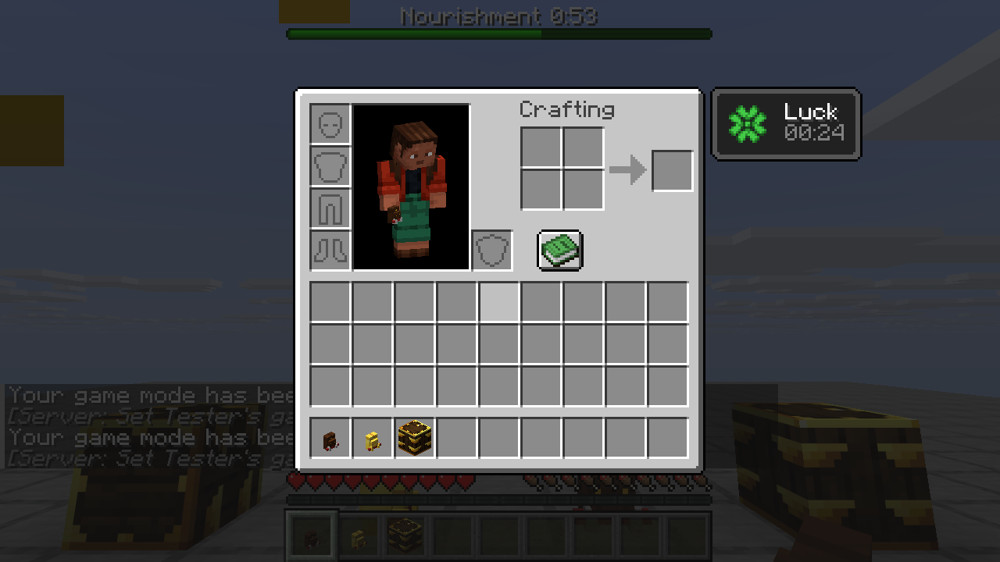
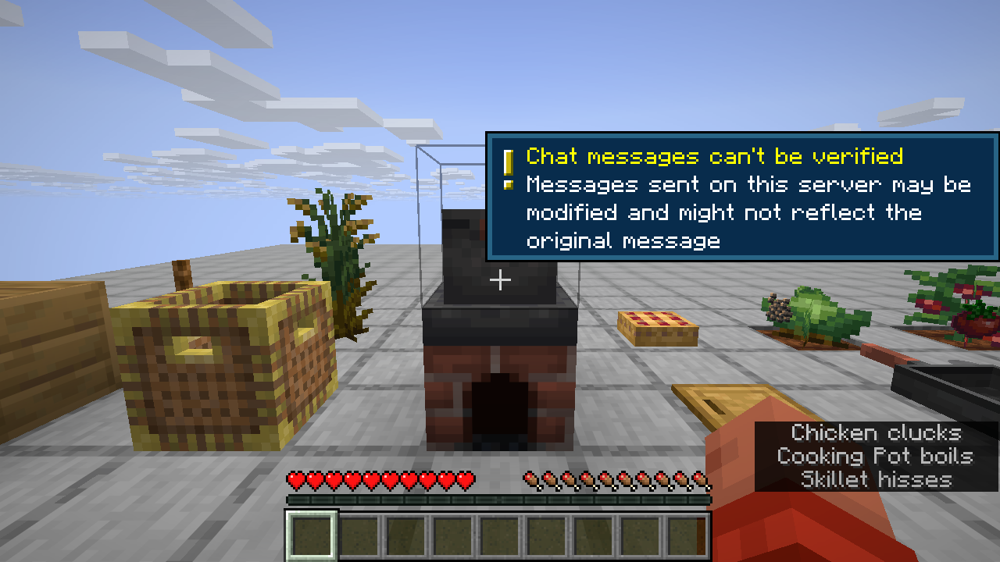
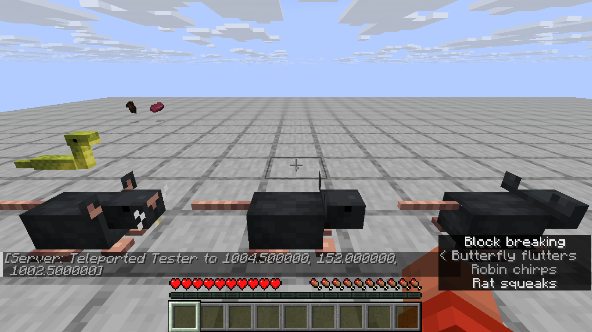
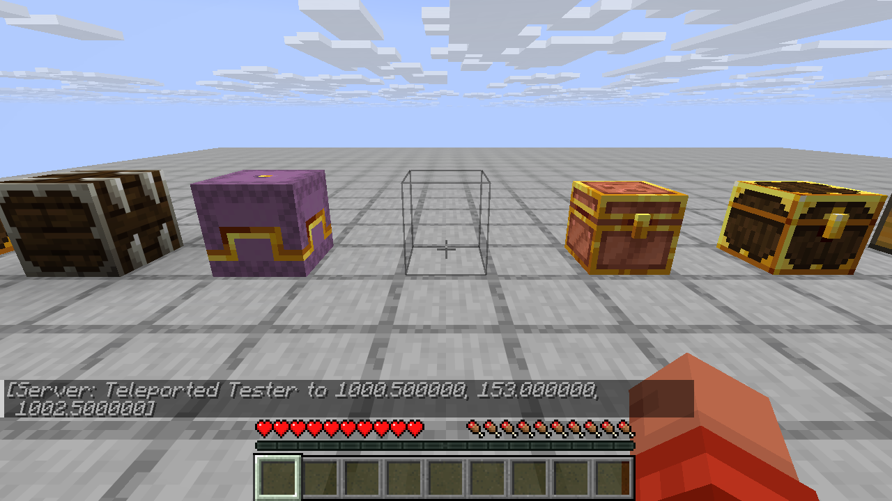
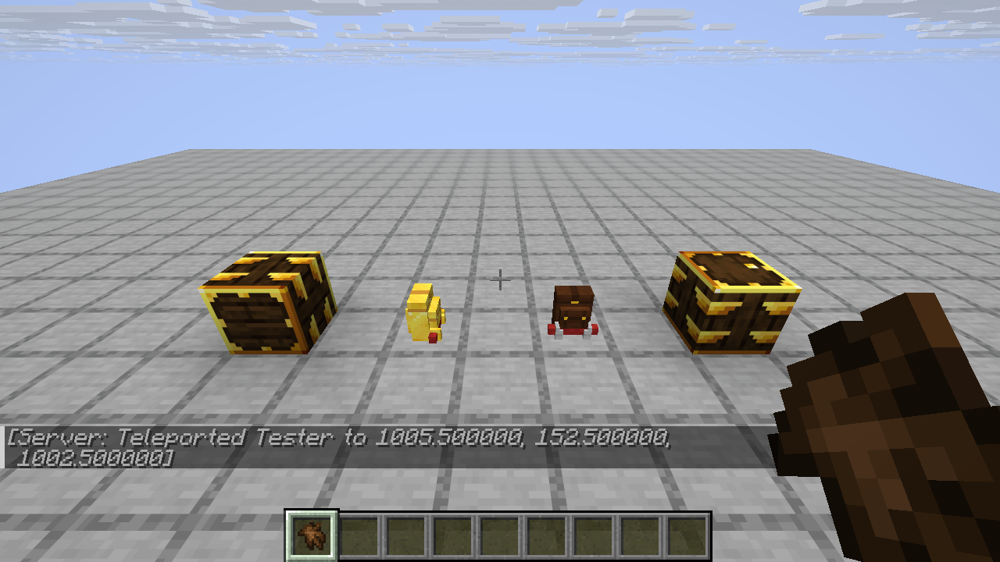
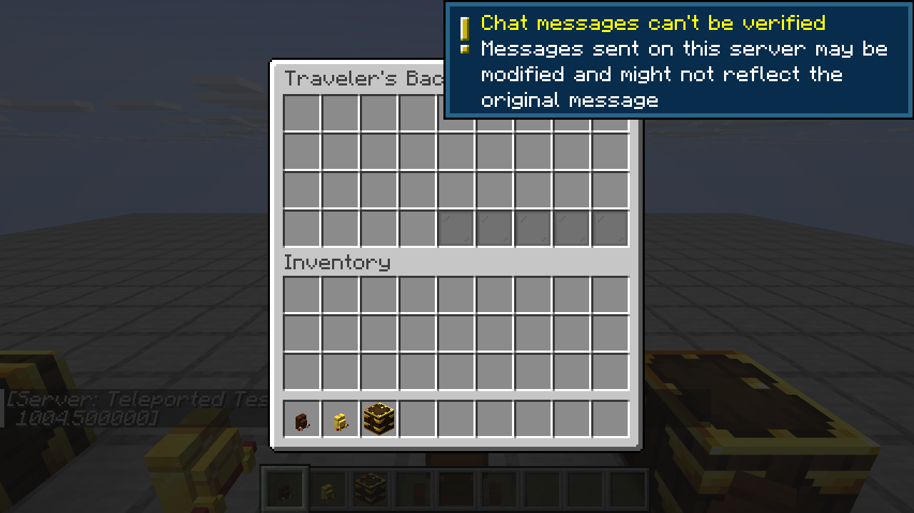
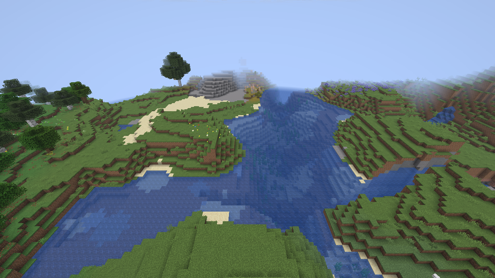
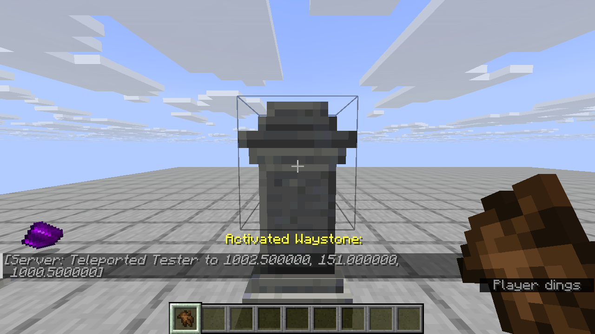

# Java2Bedrock

Server-side mods that work on unmodded clients. Players join with the stock Minecraft launcher and still see custom blocks, items, models and textures. Java comes first. Bedrock support is planned for v2.

There are two ways in. The demo mod shows how to write a mod for this setup with [Polymer](https://modrinth.com/mod/polymer). The bridge goes further and takes an ordinary Fabric mod, one written with no idea that vanilla clients exist, and makes it playable on them without touching its code. [Farmer's Delight Refabricated](https://modrinth.com/mod/farmers-delight-refabricated) is the test case.


## What's in the repo

| Path | What it is |
| --- | --- |
| `demo/` | The demo mod `j2bdemo`. It adds the Crystal Block and the Spark Wand. |
| `bridge/` | The bridge mod `j2bbridge`. Drop it next to a normal Fabric mod and vanilla clients can join. |
| `server/setup.sh` | Builds the mod and puts a runnable server in `server/run/`. |
| `tools/vanilla-client/launch.py` | Downloads a stock client from Mojang and joins a server with it. This is how the screenshots were taken. |

## Writing content

The demo mod is ordinary Fabric code. Blocks and items register the usual way, with `Registry.register`, `Item.Properties` and `BlockBehaviour.Properties`. Assets go in `assets/<modid>/` like any mod. The Polymer-specific parts come down to three things.

1. The item extends `SimplePolymerItem` instead of `Item`. The block item is a `PolymerBlockItem` instead of a `BlockItem`.
2. The block implements `PolymerTexturedBlock` and returns a block state from `getPolymerBlockState`. Polymer gives out an unused note block state, and the server resource pack points that state at the mod's model.
3. One call in `onInitialize`, `PolymerResourcePackUtils.addModAssets(MOD_ID)`, puts the mod's `assets/` folder into the resource pack that Polymer sends to players.

See [`CrystalBlock.java`](demo/src/main/java/io/github/joddabodscripts/j2b/demo/block/CrystalBlock.java) and [`SparkWandItem.java`](demo/src/main/java/io/github/joddabodscripts/j2b/demo/item/SparkWandItem.java). The toolkit planned for step 2 should hide even these three changes.

## The bridge

Put `j2b-bridge` in the server's `mods/` folder next to the mods you want to run. Nothing else changes, and nobody writes compat code. The bridge waits until every mod has registered its content, then, just before the registries freeze, it walks them and tells Polymer how to show each modded entry to a vanilla client. Mods that already depend on Polymer are left alone.

| Mod content | What vanilla clients get |
| --- | --- |
| Items | A vanilla item carrying the mod's name, model and components. The mod's item model files go into the resource pack. Model types the client doesn't know are swapped for the plain model inside them. |
| Full blocks and plants | A spare vanilla block state (note block, sapling, tripwire, kelp) pointed at the mod's own model. |
| Other block shapes | An invisible vanilla state with about the same shape, so the outline and collision fit, plus item display entities drawing the block's models. A cutting board stands on a closed trapdoor, a pot on a slab. |
| Models a mod builds in code | Baked on the server with the mod's own Fabric model loader, then written out as a plain block model. Traveler's Backpack and Lootr's barrels work this way. |
| Things drawn on blocks | The mod's own block entity renderer, run on the server. Each item it draws becomes an item display entity with the same pose. |
| Signs | The sign's own model, with its text drawn by text display entities. To edit one, the player is shown a vanilla sign in that spot while the editor is open. |
| Menus | A chest menu. Each slot sits about where the mod's screen draws it, and one cell shows progress for menus that track any. A title with no translation shows the mod's name. |
| Entities | Mobs with a renderer are drawn by the mod's own renderer, one item display entity per model part, over an invisible armor stand players can hit. Other entities become the vanilla entity sharing the base class, so a thrown item stays a thrown item. |
| Effects | A boss bar per modded effect with its name, level and time left, emptying as it runs out. Green for good effects, red for bad ones. The vanilla effect list is left alone. |
| Sounds, particles | Sounds play from the resource pack. Particles fall back to a close vanilla one. |
| Recipe book entries, data components, attributes | Kept on the server. |

### Running renderers on the server

Renderers are client code. A dedicated server has the mod's jar but not the game's client half, so the bridge supplies it:

- Before the game starts, it copies the classes that are in the vanilla client jar but not in the server jar into `j2b/client-classes-<version>.jar` and puts them on the class path. The client jar is the one Polymer already keeps for building the resource pack, so the copy happens on the second start.
- Fabric API's client-only modules (model loading, rendering, screens) ship inside the mods. Those go on the class path too.
- Each mod's client entrypoint runs, inside a try. Fabric's renderer and model layer registries are switched off on a server, so the bridge has stand-ins for them (`bridge/src/fabricStandIns`) that record what the mod registers. Setup that touches something only a real client has (key bindings, screens) stops there, after the registrations before it.
- When the resource pack is built, every block entity and entity renderer runs once. Each model part it draws becomes a generated item model, textured with the sprite the renderer asked for. Items and block models it draws are shown as they are.
- While playing, renderers run each tick for what players can see. The poses become item display entities, so lids open and mobs walk with the mod's own animation.

Models a mod builds with its own Fabric model loader (`"fabric:type"` in a model or blockstate file) are baked the same way the client would bake them. The mod's loader and the game's model baker run on the server with stand-in textures, and the faces that come out are written back as a plain block model. A block item whose model only the mod's code can draw shows its block's model.

The server must start with `-Dfabric.disableEnvironmentStrip=true`. Without it Fabric removes client-only methods from the mods, their client setup can't run, and modded mobs fall back to stand-ins. The bridge logs a warning when the flag is missing.

A renderer that needs more of the client, such as a font, the camera or the level renderer, fails on its first run. The bridge logs it once and skips it, and the block or mob still works. `BlockEntityVisuals` is still there for a renderer the bridge can't run. It takes a function that lists the items to draw and the pose for each, in the same units as a `PoseStack`.

### Farmer's Delight on a vanilla client

Checked by playing on a stock 26.3 client, with audio going to a file and subtitles on:

- Every item and block shows its real texture and name, crops grow, and advancements and recipe toasts pop up.
- The cooking pot opens and cooks. Tomato sauce came out after filling the ingredients and a bowl.
- Food sits on the cutting board, skillet and stove, drawn by Farmer's Delight's own renderers. Cutting a cabbage with a knife on the board drops the leaves, and beef in a skillet on a lit stove comes out as steak.
- Sounds play. The subtitles read "Knife cuts", "Skillet hisses" and "Cooking Pot boils".
- Comfort and Nourishment show as boss bars with the time left.
- Canvas signs show their canvas texture (plain and red tested), glowing text works, and they can be written on.
- Rotten tomatoes fly as thrown tomatoes. Steam and star particles show.
- Aiming at a cutting board or skillet gives a thin outline, not a full cube.

| | |
| --- | --- |
|  |  |
|  |  |
|  |  |

What still doesn't carry over:

- Comfort and Nourishment also tint the hunger bar in the real mod. That is HUD code, and vanilla clients don't have it.
- The sign editor shows an oak sign while typing.
- Outlines are the closest vanilla shape, not the exact one.

### Five more mods

Lootr, Naturalist, Biomes O' Plenty, Waystones and Traveler's Backpack, all on one server with Farmer's Delight, joined from a stock client:

- Lootr's chests, trapped chests, barrels, shulker boxes and pots show, lids open, and each player gets their own loot.
- Naturalist's mobs (rats, snakes, elephants, giraffes, deer, lions, bears, ducks, alligators, birds and more) walk around with their own models and animation. Hitting one plays its hurt sound.
- Biomes O' Plenty's blocks and biomes generate and show.
- Waystones show and activate.
- Traveler's Backpacks show placed and in the inventory, and open their storage.

| | |
| --- | --- |
|  |  |
|  |  |
|  |  |

Gaps found:

- Waystones' destination list opens as an empty chest. The list is a screen only the client draws, fed by the mod's own packets, and there is no menu behind it to bridge yet.
- Naturalist's crab and snail renderers ask for the camera, so those two show as stand-ins.
- Waystone runes and Lootr's chest minecart renderer don't run on the server.
- Mobs don't flash red when hit.
- A backpack's dye colour, tanks and deployed sleeping bag aren't shown. The model is baked once, as it looks when new.

## Running the server

You need Java 25, `curl` and `python3`.

```sh
./server/setup.sh
cd server/run
java -Xmx2G -Dfabric.disableEnvironmentStrip=true -jar fabric-server-launcher.jar nogui
```

`setup.sh` reads every version from `gradle.properties`. It downloads the Fabric server launcher, Fabric API, Polymer and Farmer's Delight, builds the demo mod and the bridge, and copies both into `mods/`. It also turns on Polymer's resource pack auto-hosting with `server/auto-host.json`, so players get the pack when they join. Run it again after changing the mod.

During development, `./gradlew :demo:runServer` starts a server from the IDE classpath in `run/`.

## Testing with a vanilla client

```sh
python3 tools/vanilla-client/launch.py --version 26.3 --server localhost:25565
```

The script logs in offline, so set `online-mode=false` in `server/run/server.properties` first. It writes a `servers.dat` that already accepts the server resource pack, so the client goes straight in.

On a headless Linux box, run it inside Xvfb with `SDL_VIDEO_FORCE_EGL=1` and Mesa's EGL installed (`libegl-mesa0` on Ubuntu). The 26.3 client asks for an sRGB framebuffer, and Xvfb's GLX visuals don't offer one. The docstring at the top of the script has the exact commands.

## Versions

| | |
| --- | --- |
| Minecraft | 26.3 |
| Fabric Loader | 0.20.1 |
| Fabric API | 0.165.0+26.3 |
| Polymer | 0.18.4+26.3 |
| Farmer's Delight Refabricated | 26.3-3.6.29 |
| Loom / Gradle | 1.19.3 / 9.8.2 |
| Java | 25 |
