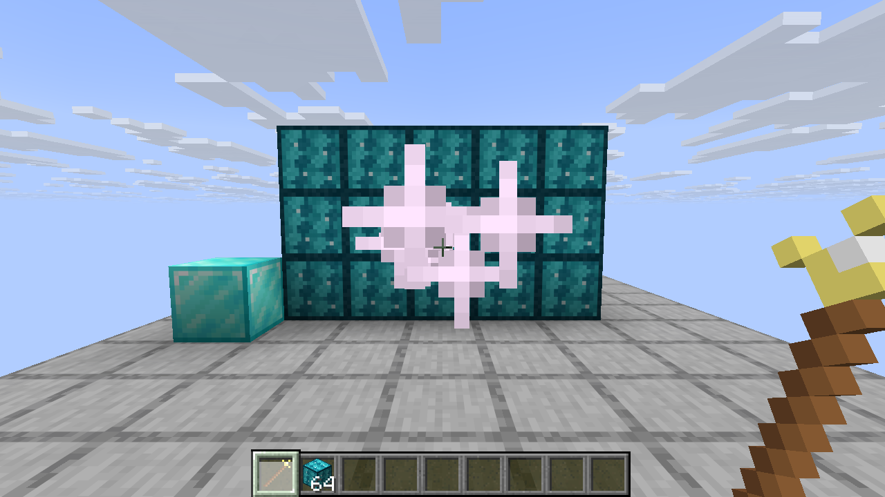

# Java2Bedrock

Server-side mods that work on unmodded clients. Players join with the stock Minecraft launcher and still see custom blocks, items, models and textures. Java comes first. Bedrock support is planned for v2.

This is step 1. It's a Fabric server on Minecraft 26.3 with [Polymer](https://modrinth.com/mod/polymer), plus a demo mod with one custom block and one custom item. Both work on a vanilla 26.3 client.



## What's in the repo

| Path | What it is |
| --- | --- |
| `demo/` | The demo mod `j2bdemo`. It adds the Crystal Block and the Spark Wand. |
| `server/setup.sh` | Builds the mod and puts a runnable server in `server/run/`. |
| `tools/vanilla-client/launch.py` | Downloads a stock client from Mojang and joins a server with it. This is how the screenshots were taken. |

## Writing content

The demo mod is ordinary Fabric code. Blocks and items register the usual way, with `Registry.register`, `Item.Properties` and `BlockBehaviour.Properties`. Assets go in `assets/<modid>/` like any mod. The Polymer-specific parts come down to three things.

1. The item extends `SimplePolymerItem` instead of `Item`. The block item is a `PolymerBlockItem` instead of a `BlockItem`.
2. The block implements `PolymerTexturedBlock` and returns a block state from `getPolymerBlockState`. Polymer gives out an unused note block state, and the server resource pack points that state at the mod's model.
3. One call in `onInitialize`, `PolymerResourcePackUtils.addModAssets(MOD_ID)`, puts the mod's `assets/` folder into the resource pack that Polymer sends to players.

See [`CrystalBlock.java`](demo/src/main/java/io/github/joddabodscripts/j2b/demo/block/CrystalBlock.java) and [`SparkWandItem.java`](demo/src/main/java/io/github/joddabodscripts/j2b/demo/item/SparkWandItem.java). The toolkit planned for step 2 should hide even these three changes.

## Running the server

You need Java 25, `curl` and `python3`.

```sh
./server/setup.sh
cd server/run
java -Xmx2G -jar fabric-server-launcher.jar nogui
```

`setup.sh` reads every version from `gradle.properties`. It downloads the Fabric server launcher, Fabric API and Polymer, builds the demo mod and copies it into `mods/`. It also turns on Polymer's resource pack auto-hosting with `server/auto-host.json`, so players get the pack when they join. Run it again after changing the mod.

During development, `./gradlew :demo:runServer` starts a server from the IDE classpath in `run/`.

## Testing with a vanilla client

```sh
python3 tools/vanilla-client/launch.py --version 26.3 --server localhost:25565
```

The script logs in offline, so set `online-mode=false` in `server/run/server.properties` first. It writes a `servers.dat` that already accepts the server resource pack, so the client goes straight in.

On a headless Linux box, run it inside Xvfb with `SDL_VIDEO_FORCE_EGL=1` and Mesa's EGL installed (`libegl-mesa0` on Ubuntu). The 26.3 client asks for an sRGB framebuffer, and Xvfb's GLX visuals don't offer one. The docstring at the top of the script has the exact commands.

## Versions

| | |
| --- | --- |
| Minecraft | 26.3 |
| Fabric Loader | 0.20.1 |
| Fabric API | 0.165.0+26.3 |
| Polymer | 0.18.4+26.3 |
| Loom / Gradle | 1.19.3 / 9.8.2 |
| Java | 25 |
