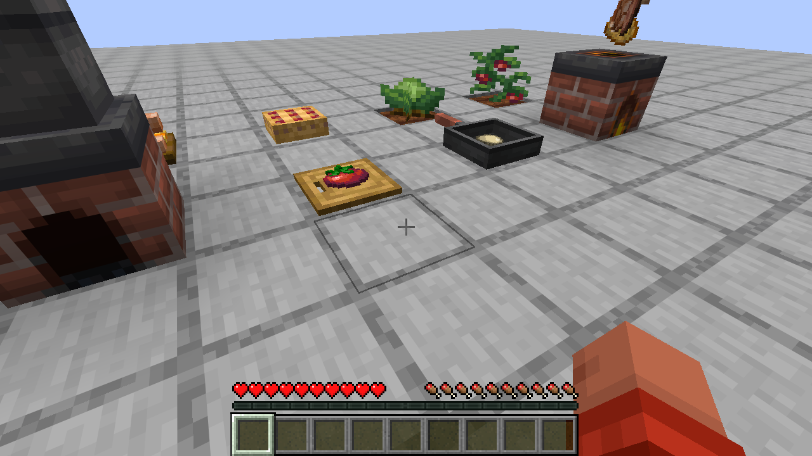
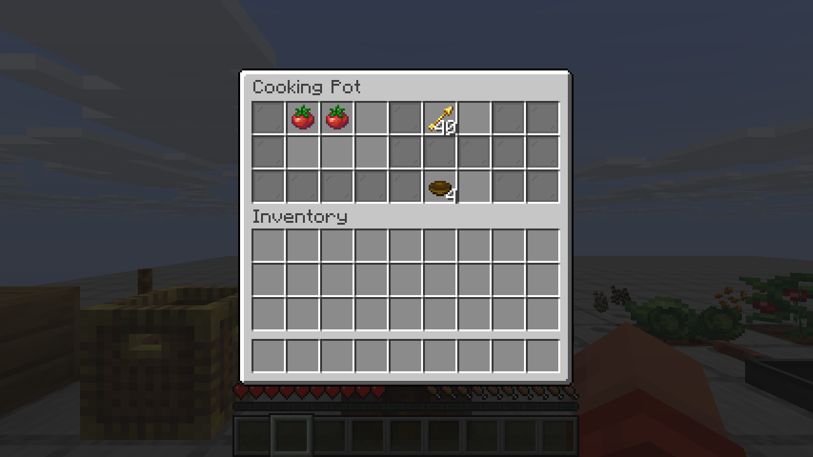
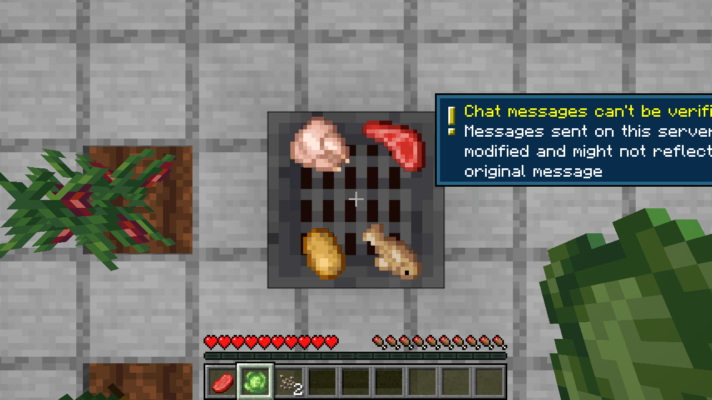
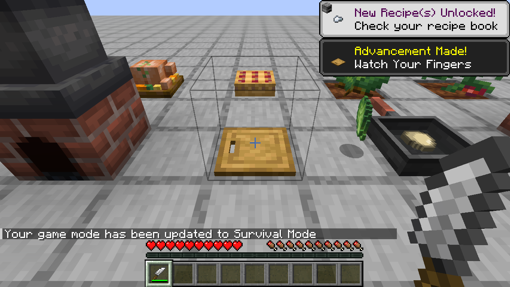
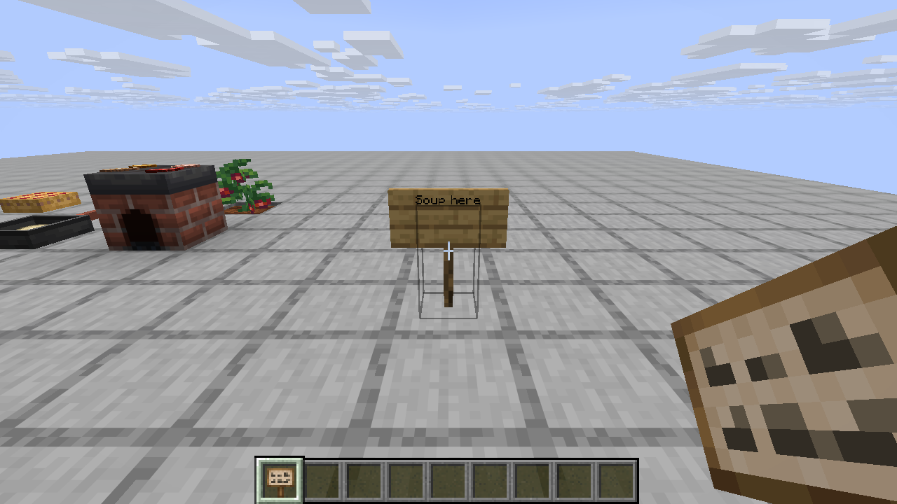

# Java2Bedrock

Server-side mods that work on unmodded clients. Players join with the stock Minecraft launcher and still see custom blocks, items, models and textures. Java comes first. Bedrock support is planned for v2.

There are two ways in. The demo mod shows how to write a mod for this setup with [Polymer](https://modrinth.com/mod/polymer). The bridge goes further and takes an ordinary Fabric mod, one written with no idea that vanilla clients exist, and makes it playable on them without touching its code. [Farmer's Delight Refabricated](https://modrinth.com/mod/farmers-delight-refabricated) is the test case.



## What's in the repo

| Path | What it is |
| --- | --- |
| `demo/` | The demo mod `j2bdemo`. It adds the Crystal Block and the Spark Wand. |
| `bridge/` | The bridge mod `j2bbridge`. Drop it next to a normal Fabric mod and vanilla clients can join. |
| `server/setup.sh` | Builds the mod and puts a runnable server in `server/run/`. |
| `tools/vanilla-client/launch.py` | Downloads a stock client from Mojang and joins a server with it. This is how the screenshots were taken. |

## Writing content

The demo mod is ordinary Fabric code. Blocks and items register the usual way, with `Registry.register`, `Item.Properties` and `BlockBehaviour.Properties`. Assets go in `assets/<modid>/` like any mod. The Polymer-specific parts come down to three things.

1. The item extends `SimplePolymerItem` instead of `Item`. The block item is a `PolymerBlockItem` instead of a `BlockItem`.
2. The block implements `PolymerTexturedBlock` and returns a block state from `getPolymerBlockState`. Polymer gives out an unused note block state, and the server resource pack points that state at the mod's model.
3. One call in `onInitialize`, `PolymerResourcePackUtils.addModAssets(MOD_ID)`, puts the mod's `assets/` folder into the resource pack that Polymer sends to players.

See [`CrystalBlock.java`](demo/src/main/java/io/github/joddabodscripts/j2b/demo/block/CrystalBlock.java) and [`SparkWandItem.java`](demo/src/main/java/io/github/joddabodscripts/j2b/demo/item/SparkWandItem.java). The toolkit planned for step 2 should hide even these three changes.

## The bridge

Put `j2b-bridge` in `mods/` next to the mods you want to run. Nothing else changes. The bridge waits until every mod has registered its content, then, just before the registries freeze, it walks them and tells Polymer how to show each modded entry to a vanilla client. Mods that already depend on Polymer are left alone.

| Mod content | What vanilla clients get |
| --- | --- |
| Items | A vanilla item carrying the mod's name, model and components. The mod's item model files go into the resource pack. Model types the client doesn't know are swapped for the plain model inside them. |
| Full blocks and plants | A spare vanilla block state (note block, sapling, tripwire, kelp) pointed at the mod's own model. |
| Other block shapes | An invisible stand-in with collision, plus item display entities drawing the block's models. |
| Signs | A vanilla oak sign with the same rotation, so text editing works. |
| Menus | A chest menu. Each slot sits about where the mod's screen draws it, and one cell shows progress for menus that track any. |
| Entities | The vanilla entity sharing the base class, so a thrown item stays a thrown item. |
| Sounds, particles | Sounds play from the resource pack. Particles fall back to a close vanilla one. |
| Recipe book entries, data components, effects, attributes | Kept on the server. |

Block entity renderers are the one place that needs code, because they only exist on the client. `BlockEntityVisuals` takes a function that lists the items a renderer would draw and the pose for each. The pose uses the same origin and units as a renderer's `PoseStack`, so the code is mostly copied from the renderer. [`FarmersDelightVisuals`](bridge/src/main/java/io/github/joddabodscripts/j2b/bridge/compat/FarmersDelightVisuals.java) does it for the cutting board, stove and skillet in about 60 lines.

```java
BlockEntityVisuals.<SkilletBlockEntity>register(id("skillet"), (skillet, out) -> {
	Direction facing = skillet.getBlockState().getValue(SkilletBlock.FACING);
	out.accept(new ItemPart(skillet.getStoredStack(), new Matrix4f()
			.translate(0.5f, 0.13f, 0.5f).rotateY(rad(-facing.toYRot())).rotateX(rad(90)).scale(0.5f),
			ItemDisplayContext.FIXED));
});
```

### Farmer's Delight on a vanilla client

Checked by playing on a stock 26.3 client:

- Every item and block shows its real texture and name, crops grow, and advancements and recipe toasts pop up.
- The cooking pot opens and cooks. Tomato sauce came out after filling the ingredients and a bowl.
- Food sits on the cutting board, skillet and stove. Cutting a cabbage with a knife on the board drops the leaves, and beef in a skillet on a lit stove comes out as steak.
- Rotten tomatoes fly as thrown tomatoes. Steam and star particles show.
- Canvas signs can be placed and written on.

| | |
| --- | --- |
|  |  |
|  |  |

What doesn't carry over:

- Comfort and Nourishment still work, but the client doesn't list them, since it can't show an effect it has never heard of. The hunger bar overlay they come with is client code, so that's gone too.
- Canvas signs look like oak signs.
- Blocks that aren't full cubes or plants have a full-cube outline when you aim at them, because the stand-in is a barrier.
- No sounds were heard during testing. The client in the test box has no audio device. The sound files are in the pack and nothing errors.

## Running the server

You need Java 25, `curl` and `python3`.

```sh
./server/setup.sh
cd server/run
java -Xmx2G -jar fabric-server-launcher.jar nogui
```

`setup.sh` reads every version from `gradle.properties`. It downloads the Fabric server launcher, Fabric API, Polymer and Farmer's Delight, builds the demo mod and the bridge, and copies both into `mods/`. It also turns on Polymer's resource pack auto-hosting with `server/auto-host.json`, so players get the pack when they join. Run it again after changing the mod.

During development, `./gradlew :demo:runServer` starts a server from the IDE classpath in `run/`.

## Testing with a vanilla client

```sh
python3 tools/vanilla-client/launch.py --version 26.3 --server localhost:25565
```

The script logs in offline, so set `online-mode=false` in `server/run/server.properties` first. It writes a `servers.dat` that already accepts the server resource pack, so the client goes straight in.

On a headless Linux box, run it inside Xvfb with `SDL_VIDEO_FORCE_EGL=1` and Mesa's EGL installed (`libegl-mesa0` on Ubuntu). The 26.3 client asks for an sRGB framebuffer, and Xvfb's GLX visuals don't offer one. The docstring at the top of the script has the exact commands.

## Versions

| | |
| --- | --- |
| Minecraft | 26.3 |
| Fabric Loader | 0.20.1 |
| Fabric API | 0.165.0+26.3 |
| Polymer | 0.18.4+26.3 |
| Farmer's Delight Refabricated | 26.3-3.6.29 |
| Loom / Gradle | 1.19.3 / 9.8.2 |
| Java | 25 |
